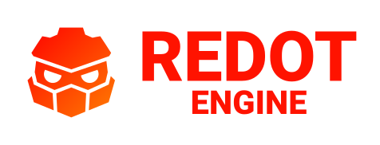

# Nova Engine

<p align="center">
  <a href="https://github.com/BigBoss316Max/nova-engine">
    
  </a>
</p>

## 2D and 3D cross-platform game engine

**Nova Engine** is a custom fork of the Redot Engine codebase, focused on building a multi-platform 2D and 3D game engine with a clearer identity and project-specific direction.

This fork keeps the Redot foundation while allowing the project to evolve under a distinct Nova branding, custom build metadata, and a dedicated roadmap for engine improvements.

## Fork status

This project is based on the open-source Redot Engine project and remains compatible with the upstream engine architecture while offering a custom Nova Engine identity.

The original Redot Engine is released under the MIT license and continues to provide the foundation for this project. Nova Engine preserves attribution and license compatibility while adapting the project for a custom development path.

## Getting the engine

### Binary downloads

Official builds for Nova Engine are managed through this repository and its local build workflow.

### Compiling from source

To compile Nova Engine from source, use the project build instructions and tooling in this repository.

#### Using Nix (recommended)

If you have the Nix package manager installed, you can build and run the editor in one command:

```bash
nix run .
```

This will automatically install the required build dependencies and compile Nova Engine if a matching binary does not already exist.

Detailed Nix usage, including passing SCons build flags through `nix run`, forwarding runtime arguments, and manual `nix develop` workflows, is documented in the `Nix usage guide` at `doc/nix.md`.

## Community and contributing

Nova Engine is a community-driven fork of Redot, designed to support custom engine evolution and feature development.

To get started contributing to the project, see the contributing guide in this repository.

## Documentation and demos

The class reference is accessible from the Nova Engine editor.

## AI Integration - Model Context Protocol (MCP)

Nova Engine supports AI integration using MCP. See the setup instructions in `doc/mcp-integration.md`.
